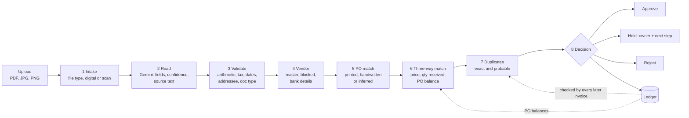
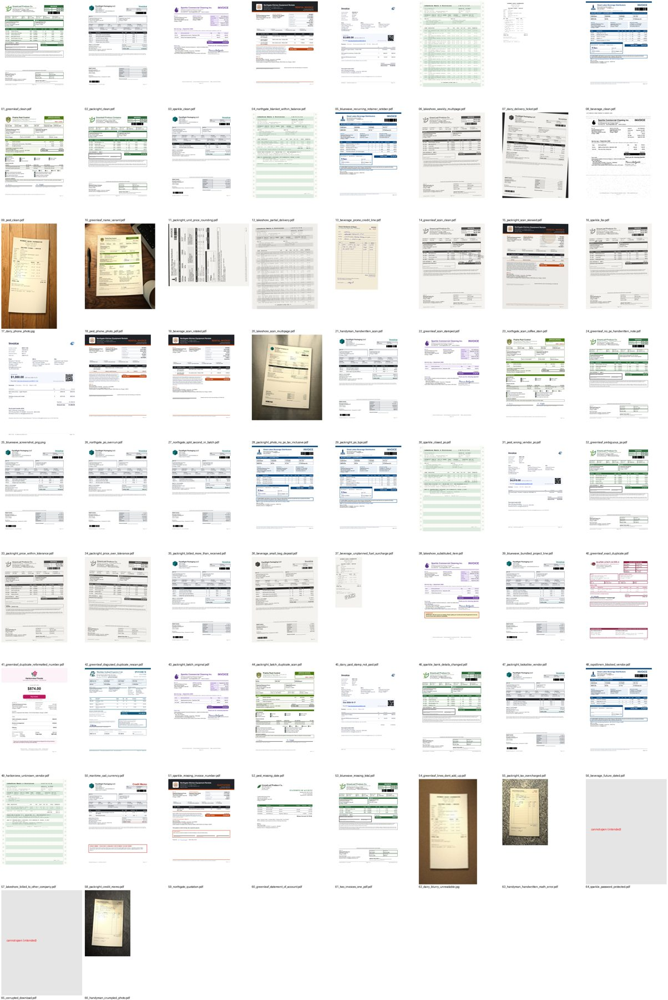

# InvoiceDesk

**Invoices in. Decisions out, with every reason shown.**

InvoiceDesk is an accounts-payable assistant built for the Zamp AI Solutions Associate case study (PS-1: invoice PDF to AP decision). Drop in one invoice or a whole inbox (digital PDFs, scans, faxes, phone photos, even handwritten carbon copies) and each one comes back **Approved**, **On hold** or **Rejected** in seconds. Every decision shows the reason, who should act, the next step, and the evidence circled on the invoice itself.

| | |
|---|---|
| **Live app** | _link added after deployment_ |
| **48-second trailer** | _link added after upload_ |
| **Original proposal** (Day 1, before the build) | [docs/InvoiceDesk_proposal.pdf](docs/InvoiceDesk_proposal.pdf) |

---

## The problem

Copperleaf Restaurant Group (a fictional company) pays its suppliers through a small AP team: about 600 invoices a month at 8 to 15 minutes each. A clerk opens each invoice, types it in, finds the purchase order, checks prices and quantities against what was ordered and delivered, checks it hasn't been paid already, and decides.

The work is slow, and the mistakes are expensive:

1. **Paying twice:** the same invoice sent again, sometimes rescanned under a new number.
2. **Overbilling across invoices:** each invoice is fine on its own, but together they exceed the PO.
3. **Paying a fraudster:** a perfect-looking invoice with changed bank details.

## The idea: AI reads, code decides

The AI model only **reads** the document and writes the plain-English explanation. Every check and every decision is made by **fixed, tested rules** (`app/rules.py`), the same way every time. An AI model never approves a payment.

Nothing the AI reads is trusted blindly:
- On digital PDFs, every key value must also be found in the PDF's own text.
- Totals have to add up.
- A bank account that differs from the vendor master on a scan is read a second time by a stronger model.
- Low confidence means hold, never a guess.

## How an invoice flows



| # | Check | What it does | Typical outcome |
|---|---|---|---|
| 1 | Intake | Identifies the file. Digital PDFs are read from their text with [LiteParse](https://github.com/run-llama/liteparse); scans and photos go to AI vision. | Unreadable or encrypted: hold |
| 2 | Read (AI) | Gemini fills a fixed schema: vendor, tax ID, invoice number, dates, PO, billed-to, currency, totals, bank details and line items, each with a confidence level and the exact text it came from. | Low confidence: hold |
| 3 | Validate | Lines add up, tax matches the printed rate, dates are valid, it's in USD, billed to Copperleaf, and actually an invoice (not a quote, statement or credit memo). | Credit memo: hold. Quote or statement: reject |
| 4 | Vendor | Matched on tax ID, then name and aliases. Checks status and compares the bank account with the vendor master. | Changed bank account: hold for Security |
| 5 | PO match | The printed or handwritten PO must exist, be open and belong to this vendor. With no PO printed, it is inferred from the line items. | PO invalid or ambiguous: hold |
| 6 | Three-way match | Price within 2% of the PO per line, quantity no more than received, and the PO's running balance (allowance: 1% or $50, whichever is greater). | Overbilling: hold for the buyer |
| 7 | Duplicates | Exact: same vendor and invoice number. Probable: same amount, near-identical lines and close dates under a new number. | Exact: reject. Probable: hold |
| 8 | Decision | Reject beats hold beats approve. The most important reason names the owner, the next step and the money stopped. | Written to the ledger |

**Batches:** reading runs in parallel (up to 32 at once), but **deciding runs one invoice at a time in upload order**. Two invoices on the same PO in one batch never see the same balance, and a duplicate inside the batch is caught. There's a test that races this 20 times with random timing.

**After the decision** (it never changes the decision): Gemini writes the summary and the email to the owner, and every value read is boxed on the page image. Digital PDFs use exact word positions from LiteParse; scans use a Gemini locate call. Values behind a hold or reject are boxed in red.

## Edge cases

| Case | What happens |
|---|---|
| **EC1: split PO overrun.** A $15,000 invoice on a $50,000 blanket PO that already has $38,000 billed | On hold for the buyer: $3,000 over. "Approve the $12,000 left on the PO and ask the vendor for a credit note." |
| **EC2: duplicate in disguise.** A paid invoice, rescanned and resent under a new number 9 days later | On hold, shown side by side with the original it matches |
| **EC3: bank details changed.** A perfect invoice asking for payment to a new account | On hold for Security: "Do not pay. Verify by calling the number on file, never the one on the invoice." |
| **EC4: messy photo, no PO.** A crumpled phone photo with tax-inclusive prices and no PO number | Approved with notes: the PO is inferred from the lines and the tax is backed out before matching |

## The test inbox: 67 synthetic invoices



`fixtures/invoices/` holds 67 invoices from 15 fictional vendors (a few deliberately missing from the vendor master), generated by `scripts/make_fixtures.py`: clean digital PDFs, office scans, faxes, rotated pages, coffee stains, phone photos on a desk, crumpled photos and handwritten carbon copies, each vendor with its own invoice design. Each one has an expected decision and the exact field values in `fixtures/manifest.json` (human-readable: [fixtures/MANIFEST.md](fixtures/MANIFEST.md)). The procurement data they're checked against (vendors, POs, goods received, the opening ledger) is in `data/seed.json`.

## Results

| Measure | Result |
|---|---|
| Correct decisions, each invoice alone | **67 / 67** |
| Correct decisions, all 67 as one batch (order-dependent traps included) | **67 / 67** |
| Field accuracy (vendor, invoice number, PO, totals, bank account, currency, line count) | **100%**; invoice date 98% (one handwritten date) |
| Time to clear the 67-invoice inbox | **about 15 s** (cached reads), **about 24 s** with live AI reads |
| AI cost | **under 1 cent per invoice** (about $5.70 per 1,000, measured on real runs) |

Models: `gemini-3.5-flash-lite` reads, writes the summaries and locates values on scans. `gemini-3.8-flash` re-reads a bank account on a scan only when it differs from the vendor master.

## A tour of the app

- **New run:** drop files, or start a prepared demo (the happy path and the 4 edge cases), the full 67-invoice inbox, or any single test invoice. **Start fresh** clears processed invoices so the same files can be run again.
- **Batch:** a live progress ring, elapsed time against "same work by hand", the decision mix, and a tile per invoice with its plain-English reason.
- **Run page:**
  - the invoice page with green, amber and red boxes;
  - an 8-step check bar;
  - a decision card with owner, money stopped, next step and the drafted email;
  - tabs for Checks, Fields, Line items, **Related** (the vendor record, every invoice on the same PO before and after this one, the original of a duplicate) and Email.
- **Dashboard:** money stopped, touchless approval rate, clerk hours saved, why invoices were stopped, and every run.
- **Procurement data:** POs with how much is billed, vendors, goods received, the ledger, and the editable policy (tolerances).
- **Test suite:** runs all 67 invoices alone and as a batch against the answer key, inside the app.
- **Assumptions:** every judgment call, written down.

## Run it locally

Requires Python 3.11 and a [Gemini API key](https://aistudio.google.com/apikey). Without a key the app still runs in **offline mode**: answers come from the test answer key instead of AI, so every screen works.

```bash
python -m venv .venv
.venv\Scripts\activate             # Windows
# source .venv/bin/activate        # macOS / Linux
pip install -r requirements-dev.txt
cp .env.example .env               # then set GEMINI_API_KEY in .env
uvicorn app.main:app --port 8000   # open http://localhost:8000
```

Offline mode on purpose: set `EXTRACTOR=truth` in `.env`.

## Tests

```bash
pytest -q                          # 101 tests: rules, storage, pipeline, API, evidence, UI wiring
python scripts/run_eval.py         # all 67 invoices against real Gemini, alone and as a batch
python scripts/run_eval.py --truth # the same, offline, with the answer-key extractor
python scripts/check_fixtures.py   # sanity-check the generated invoices against the answer key
python scripts/make_fixtures.py    # regenerate the 67 synthetic invoices
```

On Windows, prefix the scripts with `PYTHONIOENCODING=utf-8` (or `set PYTHONIOENCODING=utf-8`).

## Deploy (Render)

`render.yaml` is a Render Blueprint, so deploying is a few clicks:

1. Push this repo to GitHub.
2. In [Render](https://dashboard.render.com): **New → Blueprint**, then choose the repo.
3. When asked, paste your `GEMINI_API_KEY`. The other settings come from `render.yaml`.
4. Wait for the build, then open the URL. `/api/health` shows the model in use.

Notes:
- **Cold starts:** on the free plan the service sleeps after 15 minutes idle, and the first request then takes about a minute.
- **Data resets:** the database is a local SQLite file, so a restart resets the data to the starting state. That's fine for a demo.
- **Cost:** the 67 test invoices are pre-read in `data/extraction_cache.json`, so demo runs cost nothing.

## Configuration

| Variable | Default | Purpose |
|---|---|---|
| `GEMINI_API_KEY` | (none) | Gemini key. If it's missing, the app runs offline. |
| `GEMINI_MODEL` | `gemini-3.5-flash-lite` | Reads invoices |
| `GEMINI_REREAD_MODEL` | `gemini-3.8-flash` | Second read of a changed bank account on scans |
| `GEMINI_SUMMARY_MODEL` | `gemini-3.5-flash-lite` | Writes the summary and email; locates values on scans |
| `EXTRACT_CONCURRENCY` | `32` | How many invoices are read at once |
| `AI_TIMEOUT` | `90` | Seconds before an AI call is abandoned (the invoice is held, the batch carries on) |
| `EXTRACTOR` | `gemini` | `truth` = offline answer-key mode |
| `DB_PATH` | `data/invoicedesk.db` | SQLite file |

## Project layout

```
app/
  main.py         FastAPI app: upload, live updates (server-sent events), runs, reference data, test suite
  pipeline.py     batch runner: parallel reading, ordered deciding, write-ups and evidence afterwards
  rules.py        every check and the decision: pure functions, no AI
  extract.py      Gemini calls: the read schema and prompt, bank re-read, summary, locating values
  evidence.py     where each value sits on the page, and which values a decision depends on
  db.py           SQLite: procurement data, ledger, runs, read cache
  truth.py        offline extractor that answers from the answer key
  evaluate.py     runs the test inbox and scores decisions and fields
  static/         the web UI (plain HTML, CSS and JavaScript, no build step)
data/
  seed.json                 vendors, purchase orders, goods received, opening ledger, policy
  extraction_cache.json     pre-read test invoices, for instant and free demo runs
fixtures/
  invoices/                 the 67 test invoices
  manifest.json, MANIFEST.md   expected decision and true field values for each
  originals/                the paid original behind the disguised duplicate (EC2)
scripts/                    invoice generator (templates, fonts, assets), checker, eval runner
tests/                      101 tests
docs/                       the original proposal and the dataset picture
```

## Design decisions

- **Rules, not prompts, decide.** Payment decisions must be exact, explainable and auditable. The model's job is reading, and the rules are tested on their own (`tests/test_rules_*.py`).
- **Two reading paths.** Digital PDFs send their text, which is cheaper and lets every value be verified against the source. Scans and photos send the image, at high media resolution so digits in bank accounts aren't lost.
- **Parallel read, ordered decide.** Reading is slow and independent; deciding is milliseconds but depends on everything decided before it.
- **Holds, not guesses.** Anything uncertain (low confidence, an unverified value, an ambiguous PO) becomes a hold with an owner and a next step, never a silent approval.
- **Evidence never changes a decision.** Page images, boxes and write-ups run after the decision, and a failure there only loses the overlay.

## Known limitations

- Invoices must be PDF, JPG or PNG. Word, Excel and HEIC photos are held as unreadable.
- USD only, and one PO per invoice.
- A handwritten date can occasionally be misread. The decision is unaffected, and every date is shown with the text it was read from.
- No sign-in. It's a demo, so anyone with the link can use it.
